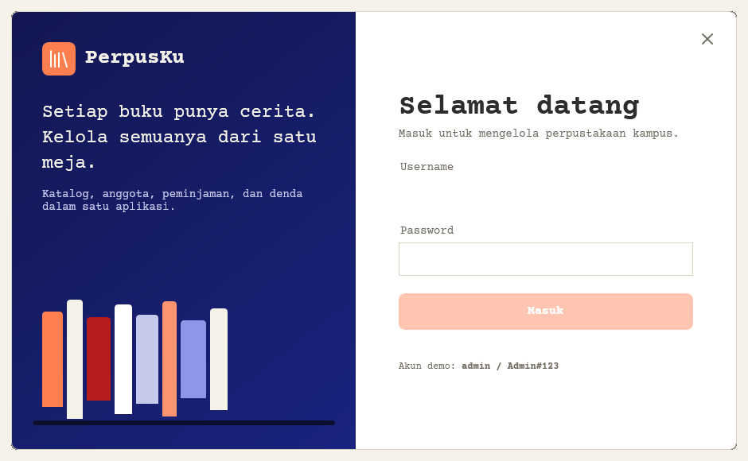
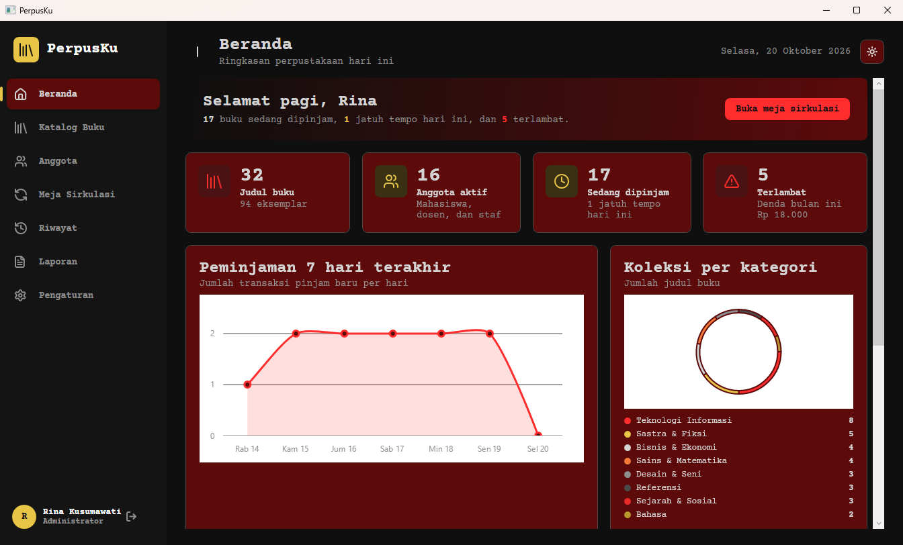
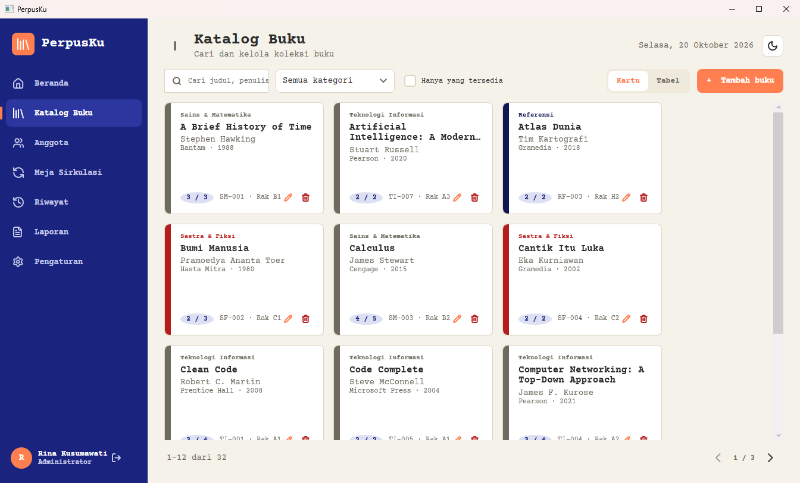
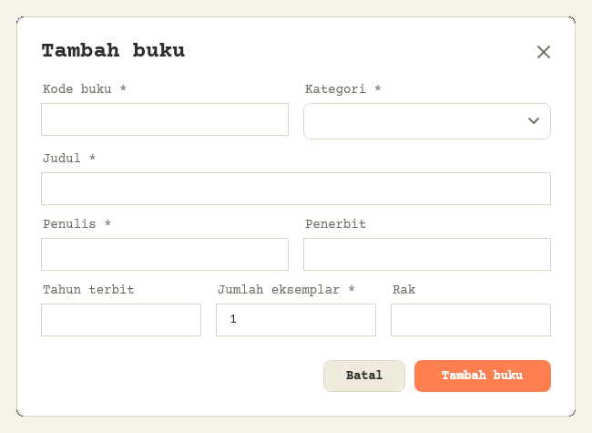
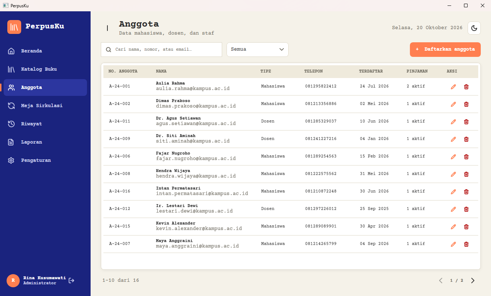
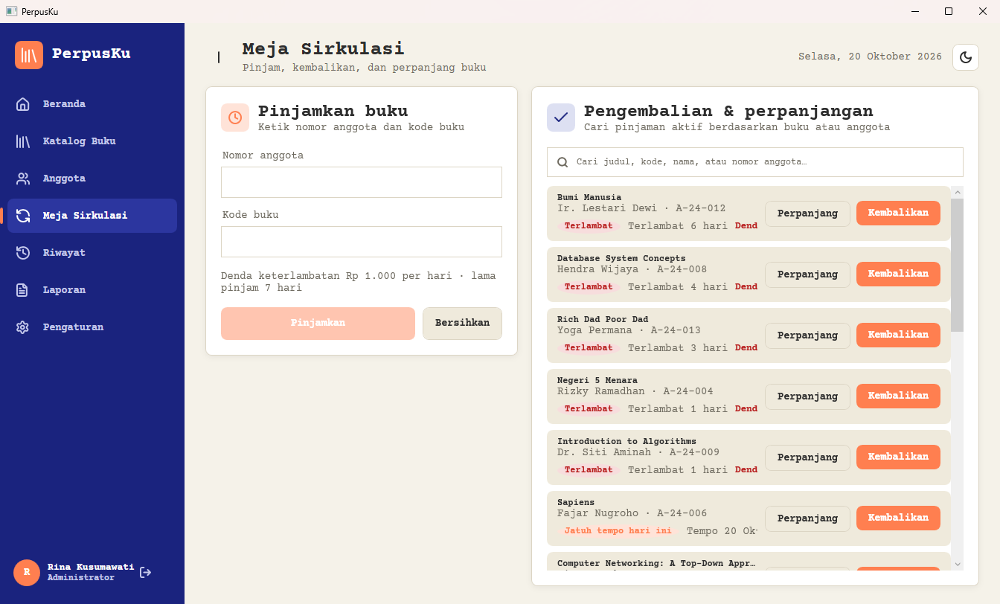
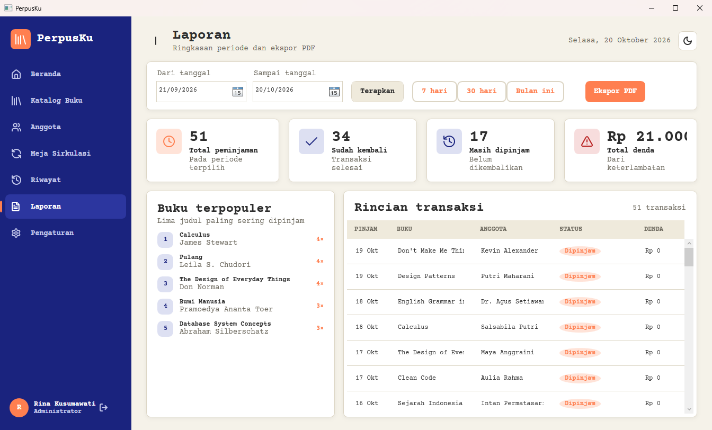

# PerpusKu

**Sistem Manajemen Perpustakaan Kampus** — aplikasi desktop Windows (WPF .NET 9) dengan SQL Server LocalDB, arsitektur MVVM, dan antarmuka bertema **Passport Travel UI** (kertas hangat, tipografi mesin tik Courier Prime, stempel, ikon garis Lucide) — mode terang & gelap, dasbor grafik, dan ekspor laporan PDF.

> *Setiap buku punya cerita. Kelola semuanya dari satu meja.*

| Login | Dasbor (terang) | Dasbor (gelap) |
|---|---|---|
|  |  |  |

---

## Daftar Isi

1. [Fitur + Tangkapan Layar](#fitur)
2. [Peran & Hak Akses](#peran--hak-akses)
3. [Alur Sirkulasi & Aturan](#alur-sirkulasi)
4. [Teknologi](#teknologi)
5. [Basis Data](#basis-data)
6. [Struktur Proyek](#struktur-proyek)
7. [Referensi File](#referensi-file)
8. [Cara Kerja Arsitektur](#cara-kerja-arsitektur)
9. [Menjalankan dari Source](#menjalankan-dari-source)
10. [Membuat .exe](#membuat-exe-untuk-dibagikan)
11. [Pemecahan Masalah](#pemecahan-masalah)
12. [Lisensi & Kredit](#lisensi--kredit)

---

## Fitur

### 1. Login & Inisialisasi Database Otomatis

Halaman masuk borderless: panel hero navy di kiri, kartu formulir bergaya kertas di kanan. Sebelum form aktif, aplikasi menghubungi LocalDB — jika database `PerpusKu_DB` belum ada, **seluruh skrip `database/01–05` dijalankan otomatis** (tabel, stored procedure, seed data awal). Gagal koneksi? Ada status jelas + tombol **Coba lagi** tanpa restart. Password diverifikasi dengan PBKDF2-SHA256 + salt; pesan gagal dibuat generik agar tidak membocorkan username mana yang benar. Preferensi tema bisa langsung diganti dari sini.


*Kunci:* `ViewModels/LoginViewModel.cs` (`InitializeAsync`, `LoginAsync`), `Services/AuthService.cs`, `Data/DatabaseInitializer.cs`, `Helpers/PasswordHasher.cs`.

### 2. Dasbor — Statistik & Grafik Real Time

Beranda berisi 7 kartu statistik (total buku, tersedia, dipinjam, anggota aktif, perlu perhatian, transaksi hari ini, denda), **grafik garis tren peminjaman 7 hari** dan **donat koleksi per kategori** (LiveCharts, warna ikut tema), daftar *Perlu Perhatian* (hampir jatuh tempo / telat) dan *Aktivitas Terbaru* dari log. Semua angka dihitung lewat view SQL, bukan loop di client.

| Terang | Gelap |
|---|---|
|  |  |

*Kunci:* `ViewModels/DashboardViewModel.cs`, `Data/Repositories/DashboardRepository.cs`, `Models/Ringkasan.cs`, `Controls/StatCard.xaml`.

### 3. Katalog Buku — Dua Tampilan, Stok Otomatis

Halaman koleksi dengan pencarian debounce (judul/penulis/penerbit), filter kategori, sakelar *hanya tersedia*, dan **toggle kartu ⇄ tabel**. Tampilan kartu bergaya stiker visa: strip warna per kategori + kode buku + status rak. Tambah/ubah/hapus dengan validasi (kode unik, tahun numerik, stok wajar) — guarded per hak akses. Hapus buku ditolak jika masih ada peminjaman aktif.



Dialog form buku tampil sebagai window chromeless (tanpa bingkai jendela) dengan error per-field inline:



*Kunci:* `ViewModels/BukuViewModel.cs` + `BukuFormViewModel.cs`, `Data/Repositories/BukuRepository.cs`, `Views/Pages/BukuView.xaml`, `Views/Dialogs/BukuFormView.xaml`.

### 4. Keanggotaan

Data anggota (mahasiswa/dosen/staf): nomor anggota auto-generate, pencarian nama/NIM/email, filter tipe, kartu dengan **StatusPill** aktif/nonaktif dan jumlah sedang dipinjam. CRUD guarded `AnggotaWrite`; nonaktifkan anggota tidak menghapus riwayat pinjamnya.



*Kunci:* `ViewModels/AnggotaViewModel.cs` + `AnggotaFormViewModel.cs`, `Data/Repositories/AnggotaRepository.cs`, `Controls/StatusPill.xaml`.

### 5. Meja Sirkulasi — Pinjam · Perpanjang · Kembali

Halaman kerja pustakawan, dua panel: **Pinjamkan** (ketik nomor anggota → info card anggota muncul; ketik kode buku → info buku + stok; validasi batas 3 buku & status aktif) dan **Kembalikan / Perpanjang** (daftar peminjaman aktif dengan pencarian, tombol perpanjang maks 1×, pengembalian menghitung **denda otomatis** per hari telat). Semua transaksi dieksekusi sebagai **stored procedure atomik** (`sp_*` dengan `XACT_ABORT`) — stok dan status berubah dalam satu transaksi database, tidak bisa setengah jalan.



*Kunci:* `ViewModels/SirkulasiViewModel.cs`, `Services/SirkulasiService.cs`, `Data/Repositories/PeminjamanRepository.cs`, `database/03_StoredProcedures.sql`.

### 6. Riwayat Transaksi

Seluruh peminjaman (aktif + selesai) dalam tabel berpager: status via view `vw_PeminjamanDetail` (Dipinjam / Terlambat / Dikembalikan), hari terlambat, jumlah perpanjangan, dan denda per baris. Pencarian + filter status.

*Kunci:* `ViewModels/RiwayatViewModel.cs`, `Data/Repositories/PeminjamanRepository.cs`, `database/05_Views.sql`.

### 7. Laporan & Ekspor PDF Resmi

Pilih periode (manual atau preset) → ringkasan periode, tabel buku terpopuler, dan daftar transaksi. Tombol ekspor menghasilkan **PDF A4 QuestPDF bergaya dokumen resmi** (kop PerpusKu, tabel bergaris; tetap terang saat dicetak).



*Kunci:* `ViewModels/LaporanViewModel.cs`, `Services/ReportService.cs`.

### 8. Pengaturan — Akun, Aturan & Tema

Ganti password (lama/baru/konfirmasi, relay PasswordBox ke VM), kelola aturan perpustakaan (`LamaPinjamHari`, `DendaPerHari`, dll. dari tabel `Pengaturan` — hanya Admin), dan pilihan tema terang/gelap yang tersimpan di `%APPDATA%\PerpusKu\prefs.json`.

*Kunci:* `ViewModels/PengaturanViewModel.cs`, `Data/Repositories/PengaturanRepository.cs`, `Services/ThemeService.cs`, `Services/SettingsCache.cs`.

### 9. Keamanan & Pengawasan

- Password **PBKDF2-SHA256, 100.000 iterasi**, salt 16 byte, perbandingan waktu-tetap (anti timing attack)
- **Semua query berparameter** — anti SQL injection (helper `Like()` meng-escape wildcard)
- **Hak akses di lapisan repository** (`Require(Permission)`), bukan hanya persembunyian tombol di UI
- **LogAktivitas** mencatat login, CRUD, transaksi, dan percobaan akses ditolak
- Error teknis → `%LocalAppData%\PerpusKu\logs\error.log`; user hanya lihat pesan ramah bahasa Indonesia

---

## Peran & Hak Akses

| Fitur | Admin | Pustakawan | Pengunjung |
|---|:---:|:---:|:---:|
| Lihat beranda & katalog | ✓ | ✓ | ✓ |
| Kelola buku & anggota | ✓ | ✓ | ✗ |
| Sirkulasi & riwayat | ✓ | ✓ | ✗ |
| Laporan & ekspor PDF | ✓ | ✓ | ✗ |
| Ubah pengaturan | ✓ | ✗ |  |

Enum `Permission`: `BukuWrite, AnggotaWrite, Sirkulasi, Laporan, KelolaPengaturan` — logika di `Services/SessionService.cs` (`Can`/`Require`). Menu navigasi dirender ulang otomatis sesuai peran saat login.

## Alur Sirkulasi

```
Cari anggota → Pilih buku → Pinjamkan → (Perpanjang maks 1×) → Kembalikan
  ketik no.      stok −1        jatuh        bila belum          stok +1
  anggota        +7 hari        tempo +7     telat               denda otomatis
```

| Aturan bawaan | Nilai |
|---|---|
| Lama pinjam | 7 hari |
| Maks buku per anggota | 3 |
| Perpanjangan | 1× |
| Denda | Rp 1.000 / hari telat |

Semua bisa diubah Admin di **Pengaturan**; aturan dibaca dari tabel `Pengaturan` lalu di-cache (`SettingsCache`).

## Teknologi

| Layer | Pilihan |
|---|---|
| Runtime | .NET 9 (`net9.0-windows`), WPF, WinExe |
| Arsitektur | MVVM — Views → ViewModels → Services → Repositories → SQL |
| Database | SQL Server / LocalDB via **Microsoft.Data.SqlClient 6.x** (ADO.NET) |
| Grafik | **LiveChartsCore.SkiaSharpView.WPF 2.0.0-rc** (SkiaSharp) |
| PDF | **QuestPDF 2025.x** (lisensi Community) |
| Font | Courier Prime (SIL OFL 1.1) — di-embed sebagai resource, bukan instalasi sistem |
| Ikon | Geometri Lucide (ISC) — ±30 `Geometry` di `Icons.xaml`, nol emoji |
| Keamanan | PBKDF2-SHA256, parameterized query, stored procedure atomik, audit log |

## Basis Data

Database `PerpusKu_DB` dibuat + di-seed otomatis saat login pertama (atau manual: jalankan `database/01…05` di SSMS).

| File | Isi |
|---|---|
| `01_CreateDatabase.sql` | Create database `PerpusKu_DB` bila belum ada |
| `02_CreateTables.sql` | 7 tabel: `Users, Kategori, Buku, Anggota, Peminjaman, Pengaturan, LogAktivitas` |
| `03_StoredProcedures.sql` | `sp_PinjamBuku`, `sp_KembalikanBuku` (hitung denda+hari), `sp_PerpanjangBuku` — semua `XACT_ABORT` (atomik) |
| `04_SeedData.sql` | 3 akun (admin/pustakawan/tamu), pengaturan default, kategori, buku contoh, anggota contoh, sinkron stok↔peminjaman aktif |
| `05_Views.sql` | `vw_PeminjamanDetail` (join lengkap + hitung hari/denda), `vw_BukuPerKategori` |

Inti skema: `Buku(StokTotal, Tersedia, Rak, KodeBuku UNIQUE)` · `Peminjaman(TanggalPinjam, JatuhTempo, TanggalKembali, StatusDb, JumlahPerpanjang, Denda)` · `Users(PasswordHash, PasswordSalt, Role)` · `Pengaturan(Kunci, Nilai, Label)`.

## Struktur Proyek

```
perpusku/
├── PerpusKu.sln
├── publish.bat                  ← build .exe self-contained ke folder publish\
├── .gitignore                   ← bin/ obj/ .vs/ publish/ release/ docs/Infografis*
├── LICENSE                      ← MIT (c) 2026 AzzuraeL
├── database/                    ← skrip SQL 01–05 (auto-run saat login pertama)
├── docs/                        ← PRD, ERD, UML, Detail Desain UI/UX, infografis, assets/ (8 screenshot)
└── src/PerpusKu.App/
    ├── Themes/                  ← 7 resource dictionary: warna, style, ikon, template
    ├── Views/                   ← 2 window + 7 page + 4 dialog (+ .xaml.cs masing-masing)
    ├── ViewModels/              ← 12 VM + Base/ (4 fondasi MVVM)
    ├── Services/                ← 9 service (auth, sirkulasi, laporan, tema, toast, …)
    ├── Data/                    ← Db, initializer, reader ext + 8 Repositories/
    ├── Models/                  ← 7 entity/DTO
    ├── Controls/                ← 4 user control (StatCard, SearchBox, PagerBar, StatusPill)
    ├── Converters/              ← 8 IValueConverter
    ├── Helpers/                 ← PasswordHasher, Validator
    ├── Fonts/                   ← Courier Prime .ttf (4 varian)
    ├── appsettings.json         ← connection string
    └── PerpusKu.App.csproj
```

## Referensi File

### Root & konfigurasi

| File | Fungsi |
|---|---|
| `App.xaml` | Deklarasi `Application` tanpa StartupUri; menggabungkan 6 resource dictionary (LightTheme, Tokens, Icons, Converters, Styles, Templates) |
| `App.xaml.cs` | `OnStartup`: set culture `id-ID`, pasang global exception handler, muat tema tersimpan; `ShowLogin()`/`ShowShell()` untuk alur jendela |
| `appsettings.json` | `ConnectionStrings.PerpusKu` → `(localdb)\MSSQLLocalDB`, db `PerpusKu_DB`, Trusted Connection |
| `PerpusKu.App.csproj` | WinExe `net9.0-windows` + `UseWPF`; PackageReference: Microsoft.Data.SqlClient 6.*, LiveChartsCore.SkiaSharpView.WPF 2.0.0-rc*, QuestPDF 2025.*; embedding `Fonts/*.ttf` + salin `../../database/*.sql` ke output |
| `PerpusKu.sln` · `publish.bat` · `LICENSE` · `.gitignore` | Solution; skrip publish self-contained win-x64 single-file; MIT; ignore build & hasil |

### Models/ — entity & DTO

| File | Isi |
|---|---|
| `Buku.cs` | `Buku`: BukuId, KodeBuku, Judul, Penulis, Penerbit, Tahun, KategoriId/Nama, StokTotal, Tersedia, Rak |
| `Anggota.cs` | `Anggota`: AnggotaId, NomorAnggota, Nama, Tipe, Email, Telepon, TanggalDaftar, SedangPinjam |
| `Peminjaman.cs` | `Peminjaman`: id buku/anggota + tanggal pinjam/jatuh tempo/kembali, `StatusDb`, `JumlahPerpanjang`, `Denda`, `HariTerlambat`, properti turunan (label status, warna) |
| `Kategori.cs` | `Kategori` (KategoriId, Nama, JumlahBuku) + override `ToString()` untuk ComboBox |
| `User.cs` | `User` (UserId, Username, NamaLengkap, Role) & `UserCredential` (User + hash + salt) |
| `LogAktivitas.cs` | `LogAktivitas`: JenisAksi, Deskripsi, NamaUser, Waktu — feed dasbor |
| `Ringkasan.cs` | DTO agregat: `DashboardStat` (7 metrik), `TitikData` (grafik), `BukuPopuler`, `RingkasanLaporan`, `PengaturanItem` |

### Data/ — akses database

| File | Isi |
|---|---|
| `Db.cs` | Static: baca connection string dari appsettings, `OpenAsync()` → `SqlConnection` |
| `DatabaseInitializer.cs` | `EnsureAsync`: cek `SELECT DB_ID('PerpusKu_DB')`; hilang → jalankan 01; view/procedure kurang → jalankan 02 dst (split per `GO`) |
| `ReaderExtensions.cs` | Extension `Str/Int/IntN/Dec/Date/DateN` untuk SqlDataReader, `Add()` parameter SqlCommand, `Like()` escape wildcard |
| `Repositories/UserRepository.cs` | `dbo.Users (IsActive=1)`: `GetByUsernameAsync`, `GetByIdAsync`, `UpdatePasswordAsync`, mapping `UserCredential` |
| `Repositories/BukuRepository.cs` | CRUD `dbo.Buku` join `Kategori`; `GetByKode`, `Exists` (cek kode unik), delete ditolak bila ada peminjaman aktif; guard `Require(BukuWrite)` |
| `Repositories/AnggotaRepository.cs` | CRUD `dbo.Anggota` (filter aktif/tipe, LIKE); `NextNomorAsync` auto-nomor; hitung `SedangPinjam`; guard `Require(AnggotaWrite)` |
| `Repositories/PeminjamanRepository.cs` | Query `vw_PeminjamanDetail`; transaksi lewat `sp_PinjamBuku`/`sp_KembalikanBuku` (hasil denda+hari)/`sp_PerpanjangBuku`; guard `Require(Sirkulasi)` |
| `Repositories/KategoriRepository.cs` | Baca `vw_BukuPerKategori` → daftar kategori + jumlah buku |
| `Repositories/DashboardRepository.cs` | Agregasi statistik lintas tabel, tren pinjam, perlu-perhatian, ringkasan laporan, buku populer |
| `Repositories/PengaturanRepository.cs` | Baca/update `dbo.Pengaturan`; `UpdateAsync` guard `Require(KelolaPengaturan)`; `LoadCacheAsync` isi `SettingsCache` |
| `Repositories/LogRepository.cs` | `AddAsync` INSERT `LogAktivitas` (user sesi, deskripsi potong 250 char, error log sendiri tidak boleh menggagalkan fitur) |

### Services/ — logika aplikasi

| File | Isi |
|---|---|
| `AuthService.cs` | `LoginAsync` (verifikasi hash → `SignIn` → `LoadCacheAsync`; pesan error generik), `ChangePasswordAsync` (min 8, huruf+angka) |
| `SessionService.cs` | Static `Current`/`IsLoggedIn`; enum `Permission`; `Can`/`Require`: Admin lolos semua, Pustakawan tanpa KelolaPengaturan, selain itu read-only |
| `SirkulasiService.cs` | Facade meja sirkulasi: `CariBukuAsync`, `CariAnggotaAsync`, `CariAktifAsync`, `PinjamAsync`, `KembalikanAsync`, `PerpanjangAsync`, formatter `Rupiah` |
| `ReportService.cs` | `ExportPdfAsync` → PDF A4 QuestPDF: kop, ringkasan, buku populer, tabel transaksi periode |
| `ThemeService.cs` | Swap dictionary index-0 Light↔Dark, event `Changed`, persist `%APPDATA%\PerpusKu\prefs.json` (`LoadSaved/Apply/Toggle/Save`) |
| `SettingsCache.cs` | Cache aturan: `DendaPerHari` (default 1000), `LamaPinjamHari` (default 7) |
| `DialogService.cs` | Static `ShowDialog(vm)` membuka `DialogWindow` (owner = window aktif); `Confirm()` untuk konfirmasi berbahaya |
| `ToastService.cs` | Notifikasi in-window: enum `ToastKind` (Success/Error/Info), maks 4 item, auto-hide DispatcherTimer |
| `ErrorHandler.cs` | `DomainException`; `ToFriendlyMessage` (SqlException/timeout → bahasa Indonesia), `Handle` → toast, `Log` → `%LocalAppData%\PerpusKu\logs\error.log` |

### Helpers/

| File | Isi |
|---|---|
| `PasswordHasher.cs` | PBKDF2-SHA256 100.000 iterasi + salt 16 byte; `Hash()`, `Verify()` waktu-tetap |
| `Validator.cs` | `Required`, `OptionalMax`, `Email` (MailAddress), `IntRange`, `Phone` — pesan error Indonesia |

### ViewModels/ — MVVM

| File | Isi |
|---|---|
| `Base/ViewModelBase.cs` | Basis `INotifyPropertyChanged`: `Set<T>` + `OnPropertyChanged`, `IsBusy` |
| `Base/RelayCommand.cs` | `RelayCommand` (sync) & `AsyncRelayCommand` (guard `_running`), requery via `CommandManager` |
| `Base/PagedListViewModel.cs` | Daftar berhalaman: `PageItems`, PageSize 10, `TotalPages/CanPrev/CanNext`, Prev/NextCommand, `SetItems` |
| `Base/DialogViewModelBase.cs` | VM dialog: `Title` + event `CloseRequested(bool?)` |
| `ShellViewModel.cs` | Window utama: singleton `Instance`, `NavItem` sesuai izin, `Navigate(key)` → `CurrentPage`, rail expand, info user/tanggal, koleksi Toasts |
| `LoginViewModel.cs` | Username/Password/Error/Status, `InitializeAsync` (jalankan initializer → DbReady/DbFailed), `LoginAsync`, event `LoginSucceeded` |
| `DashboardViewModel.cs` | `Stat`, chart LiveCharts (garis tren + donat kategori, palette ikut tema), `Legend`, PerluPerhatian, Aktivitas, re-render `OnThemeChanged` |
| `BukuViewModel.cs` | Daftar buku: search, filter kategori, `HanyaTersedia`, toggle kartu/tabel (PageSize 12/10), CRUD guarded |
| `BukuFormViewModel.cs` | Dialog buku: 7 field + error per field, `KategoriList`, `Validate()`, `SaveAsync` (cek kode unik), mode tambah/edit |
| `AnggotaViewModel.cs` | Daftar anggota: search debounce 300ms, filter Tipe, Tambah/Edit/Hapus guarded `Can(AnggotaWrite)` |
| `AnggotaFormViewModel.cs` | Dialog anggota: Nomor/Nama/Tipe/Email/Telepon + error, `Validate()`, `SaveAsync`, `TipeList` Mahasiswa/Dosen/Staf |
| `SirkulasiViewModel.cs` | Lookup realtime anggota/buku, form pinjam, daftar aktif + keyword, aksi Pinjam/Kembalikan/Perpanjang, reload debounce |
| `RiwayatViewModel.cs` | PagedList riwayat: search + filter status (Semua/Dipinjam/Terlambat/Dikembalikan) |
| `LaporanViewModel.cs` | Rentang Dari/Sampai + preset, validasi, ringkasan, `Populer`, `Rows`, `ExportAsync` (SaveFileDialog) |
| `PengaturanViewModel.cs` | Toggle tema, ubah password (Old/New/Confirm), muat/simpan aturan guarded `KelolaPengaturan`; `EditableSetting` |
| `ConfirmViewModel.cs` | Dialog konfirmasi: Title, Message, ConfirmText, IsDanger, perintah Confirm/Cancel |

### Views/ — XAML

| File | Isi |
|---|---|
| `LoginWindow.xaml(.cs)` | Jendela borderless: kartu form, status DB, retry, toggle tema; code-behind sinkron PasswordBox + drag |
| `ShellWindow.xaml(.cs)` | Kerangka utama: rail navigasi Items, header judul/tanggal, ContentControl halaman, overlay toast, collapse sidebar |
| `Pages/DashboardView.xaml` | Baris StatCard + 2 chart LiveCharts + PerluPerhatian + Aktivitas |
| `Pages/BukuView.xaml` | Search, filter, toggle tersedia, mode kartu/tabel, pager, aksi CRUD |
| `Pages/AnggotaView.xaml` | Search, filter tipe, kartu anggota + StatusPill, pager, aksi CRUD |
| `Pages/SirkulasiView.xaml` | Form pinjam (anggota+buku info card), daftar aktif + aksi kembalikan/perpanjang |
| `Pages/RiwayatView.xaml` | Tabel peminjaman berpager + pill status + denda, search & filter |
| `Pages/LaporanView.xaml` | Pemilih periode + preset, ringkasan, tabel populer & transaksi, ekspor PDF |
| `Pages/PengaturanView.xaml` | Pilihan tema, form ubah password (3 PasswordBox), tabel aturan + simpan |
| `Dialogs/BukuFormView.xaml` | Field buku + error inline, ComboBox KategoriList |
| `Dialogs/AnggotaFormView.xaml` | Field anggota + error inline, ComboBox TipeList |
| `Dialogs/ConfirmView.xaml` | Pesan + batal/konfirmasi (danger style saat `IsDanger`) |
| `Dialogs/DialogWindow.xaml(.cs)` | Chromeless host dialog: header judul, close, drag; konten via ContentControl |

*Catatan: seluruh `.xaml.cs` Pages/Dialogs minimal (hanya `InitializeComponent`) — logika ada di ViewModel, kecuali relay PasswordBox.*

### Controls/ — user control reusable

| File | Fungsi |
|---|---|
| `StatCard.xaml` | Kartu statistik dasbor — DP: `Label, Value, Caption, Glyph, AccentBrush, SoftBrush` |
| `SearchBox.xaml` | Kotak cari + ikon + watermark — DP: `Text` (two-way), `Placeholder` |
| `PagerBar.xaml` | Pager Prev/Next — DP: `PageNumber, TotalPages, RangeText` |
| `StatusPill.xaml` | Pill status berwarna — DP: `Status, Text` (sinkron otomatis) |

### Themes/ — resource dictionary

| File | Isi |
|---|---|
| `Tokens.xaml` | Non-warna: `HeadFont/BodyFont` (Courier Prime embedded), `RadiusSm/Md/Lg`, `CardShadow` |
| `LightTheme.xaml` | 29 brush terang: `BgBrush #F5F2E9, Primary #FF7F50, Accent #1A237E, Danger #B71C1C`, rail & hero gradient |
| `DarkTheme.xaml` | 29 brush gelap, key identik (arang + emas) — ditukar runtime oleh ThemeService |
| `Icons.xaml` | ±30 `Geometry` kunci `Icon.*` gaya Lucide: book-open, check, chevron, clock, house, library, moon, sun, pencil, plus, save, search, settings, trash-2, user, users, x, dll |
| `Styles.xaml` | ±30 style: window base, TextBlock (H1/H2/Muted/FieldLabel/FieldError), IconPath, Card, tombol (Primary/Danger/Ghost/Icon/Nav), TextBox, PasswordBox, CheckBox, ComboBox+template, DatePicker, DataGrid, FocusRing, Pill |
| `Templates.xaml` | DataTemplate implisit: memetakan 10 ViewModel → View-nya otomatis |
| `Converters.xaml` | Registrasi 9 converter jadi resource global |

### Converters/ & Fonts/

| File | Isi |
|---|---|
| `Converters/Converters.cs` | 8 `IValueConverter`: `IconGeomConverter` (nama→Geometry), `InverseBoolToVisibility`, `InverseBool`, `StatusSoftBrush`, `StatusFgBrush`, `CategoryBrush`, `RoleToText`, `KeyToBrush` + helper `Res` |
| `Fonts/CourierPrime-*.ttf` | 4 varian (Regular/Bold/Italic/BoldItalic) di-embed via csproj — konsisten di semua mesin tanpa instal font |

---

## Cara Kerja Arsitektur

```
User → View (XAML, binding+command)
         ↓
     ViewModel (INotifyPropertyChanged, validasi input, state halaman)
         ↓
     Service (alur use-case: auth, sirkulasi, laporan, tema, toast)
         ↓
     Repository (SQL berparameter + guard Require(Permission))
         ↓
     SQL Server LocalDB (tabel, view, sp_* atomik)
```

- **View → VM** hanya binding & command; code-behind nyaris kosong.
- **VM tidak kenal SQL**; **Repository tidak kenal WPF** (kecuali converter resource).
- **DataTemplate implisit** (`Templates.xaml`) memilih View dari tipe VM — navigasi tinggal `Navigate("buku")`.
- **Tema** = satu dictionary aktif index 0; ganti = tukar file, semua DynamicResource ikut (termasuk chart).
- **Denda** dihitung di `sp_KembalikanBuku` (DATABASE), bukan di client — tidak bisa dimanipulasi UI.

## Menjalankan dari Source

Prasyarat: **.NET SDK 9** + **SQL Server Express LocalDB** (Visual Studio Installer → *Individual components* → *SQL Server Express LocalDB*).

```powershell
git clone <repo-url> PerpusKu
cd PerpusKu
dotnet run --project src\PerpusKu.App
```

Database dibuat & di-seed otomatis saat login pertama (butuh hak `CREATE DATABASE` sekali; alternatif: jalankan `database/01…05` manual di SSMS).

### Akun demo

| Peran | Username | Password |
|---|---|---|
| Admin | `admin` | `Admin#123` |
| Pustakawan | `pustakawan` | *(di-set lewat Pengaturan → Akun saya, lihat catatan)* |
| Pengunjung | `tamu` | `Tamu#123` |

> Ganti seluruh password demo sebelum dipakai sungguhan (Pengaturan → Akun saya).

### Pakai SQL Server biasa (bukan LocalDB)

Ubah `ConnectionStrings:PerpusKu` di `src/PerpusKu.App/appsettings.json`:

```
Server=localhost\SQLEXPRESS;Database=PerpusKu_DB;Trusted_Connection=True;Encrypt=False;TrustServerCertificate=True
```

## Membuat .exe untuk Dibagikan

```powershell
.\publish.bat          # hasil di folder publish\
```

atau manual:

```powershell
dotnet publish src\PerpusKu.App -c Release -r win-x64 --self-contained true `
  -p:PublishSingleFile=true -p:IncludeNativeLibrariesForSelfExtract=true -o publish
```

Bagikan **seluruh isi folder `publish`** (di-zip) — bukan hanya `PerpusKu.exe`: folder `Database\`, `LatoFont\`, dan `appsettings.json` wajib ikut. Komputer tujuan tidak perlu .NET, tetapi tetap perlu LocalDB/SQL Server.

## Pemecahan Masalah

| Gejala | Solusi |
|---|---|
| "Database belum bisa diakses" di login | Cek LocalDB: `sqllocaldb info`. Lalu klik **Coba lagi** |
| NuGet restore gagal | Periksa koneksi internet / sumber nuget.org |
| Galat versi paket | Naikkan versi LiveCharts/QuestPDF di `PerpusKu.App.csproj` ke stabil terbaru |
| Aplikasi terkunci saat build | Tutup proses: `taskkill /im PerpusKu.exe` |
| Log kesalahan | `%LocalAppData%\PerpusKu\logs\error.log` |
| Preferensi tema korup | Hapus `%APPDATA%\PerpusKu\prefs.json` |

## Lisensi & Kredit

- **MIT** © 2026 AzzuraeL (lihat `LICENSE`)
- **Courier Prime** — font mesin tik, SIL Open Font License 1.1
- **Lucide** — ikon garis, ISC license
- **QuestPDF Community** — gratis untuk proyek open-source/perorangan

Dokumen terkait di `docs/`: `PRD_PerpusKu.docx` · `Detail_Desain_UIUX.docx` · `ERD_PerpusKu.png` · `UML/UseCase_PerpusKu.png` · `UML/Arsitektur_PerpusKu.png`.
